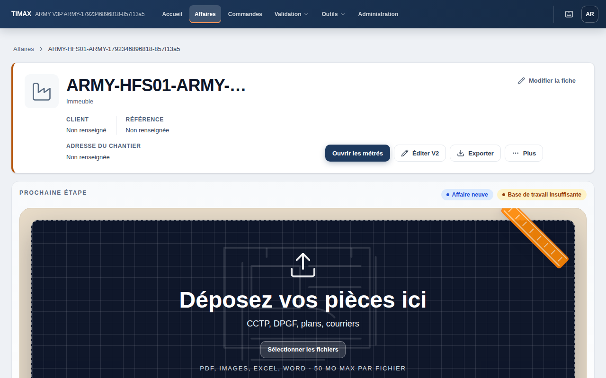
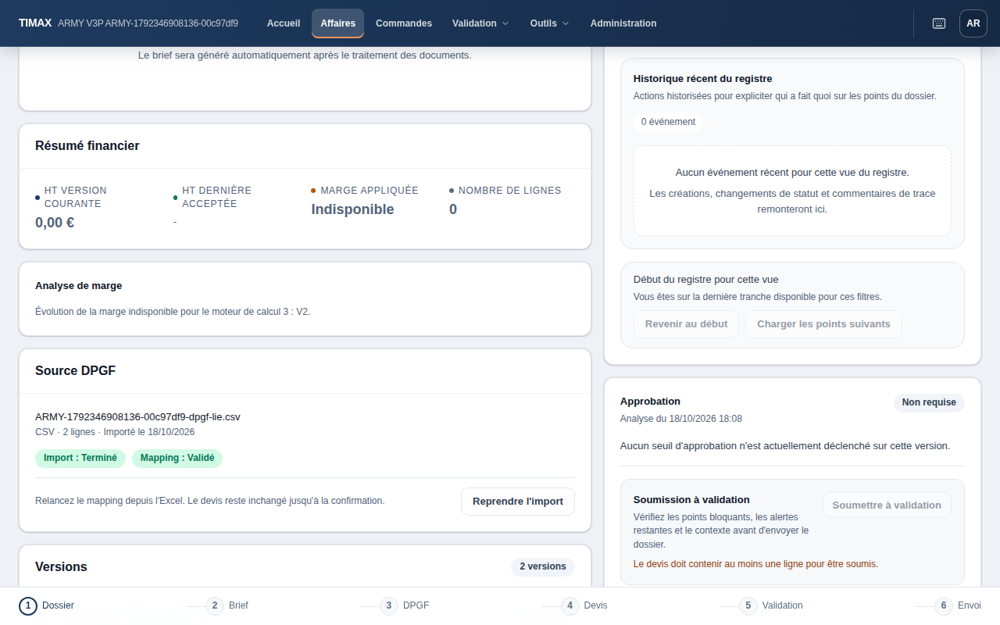
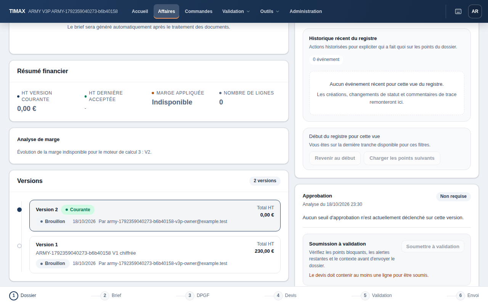

# Démarrage du hub après une version chiffrée : note de décision (18/10/2026)

Résidu préexistant, tous moteurs, laissé ouvert par la PR #63 (`docs/testing/estimate-engine-v3-2.10a.md` §10).
Décision du propriétaire : **option A**, appliquée (§ Décision et correction). Les sections suivantes décrivent
l'état d'avant la correction.

## Ce qui se passe

Le hub d'une affaire passe en démarrage (`isAffaireFreshStartState`, `src/components/affaires/AffaireHub.tsx:157`)
dès que sa version courante, celle au numéro le plus haut, n'a aucune ligne, sans document ni DPGF lié. Le démarrage
masque tout le pilotage, pas seulement la carte de marge : résumé financier, analyse de marge, chronologie des
versions, registre, approbation et journal, panneau de pilotage, barre d'étapes (`AffaireHub.tsx:971-1267`).

Vérifié dans l'interface : une V1 chiffrée (230,00 € HT) suivie d'une V2 vierge par « Créer directement » ramène
l'affaire à l'écran d'une affaire neuve. Seuls « Éditer V2 » et « Continuer en manuel » (vers la V2) restent ; la V1
n'est plus accessible depuis le hub, même envoyée ou acceptée. Le 17/10, le parcours EUHIST du 2.5 est déjà tombé
sur cet écran (`estimate-engine-v3-2.5.md`, C3). Depuis la bascule 2.10b (#68), une entreprise sans politique crée
des v3 : la V2 vierge d'une affaire v2 y est une v3. HFS02 devient donc le cas par défaut, et HFS01 celui d'une
politique 2 explicite.

## Défaillances observées (`e2e/army/local/affaire-hub-fresh-start.e2e.ts`, run GitHub 39152567828)

| # | Défaillance | Observé | Parcours |
|---|---|---|---|
| H1 | V1 chiffrée (v2), puis V2 vierge v2 : le hub repasse en démarrage | V1 seule : résumé, carte de marge (indicateurs) et « 1 version ». Après la V2 : aucune des trois cartes, « Affaire neuve », manuel vers la V2 | HFS01 |
| H2 | V1 chiffrée (v2), puis V2 vierge v3 : même démarrage, sans l'avis v3 | aucune carte, donc aucun avis « … moteur de calcul 3 : V2. » | HFS02 |
| H3 | Hors démarrage (DPGF lié), l'analyse et le résumé ne lisent que la version courante | v2 : résumé à 0,00 € et « 2 versions », **aucune carte de marge**. v3 : carte avec l'avis seul, sans indicateurs ni graphique (capture ci-dessous). Le point de marge de la V1 n'est tracé dans aucun cas | HFS01, HFS02 |
| H4 | Le bandeau « Affaire neuve » et la zone de dépôt ne dépendent que des documents (`showEmptyUploadCard`, `AffaireFlowHierarchyPanel.model.ts:368`) | affichés dans tous les états lus : V1 chiffrée, V2 vierge, DPGF lié | HFS01, HFS02 (attendu au démarrage, relevé ailleurs) |

H3 découle d'un second filtre, indépendant du démarrage : `fetchAffaireHubMarginAnalysisWithContext`
(`src/lib/affaires/server.ts`, retours anticipés sans ligne ni section racine) s'arrête sur une version courante
vide. L'évolution ne lit pourtant que les versions enregistrées (`buildMarginVersionEvolution` : multiplicateur,
total HT).

### Preuves (18/10/2026)

| Run | Révision, commande | Résultat | Preuves |
|---|---|---|---|
| Local, `main` courant | `dc7cfa87` (après #67 et #68), plus le parcours et l'entrée de `e2e.config.ts` ; clone WSL `~/miaouffrage-hub-fresh-start`, Node 24.19.0, Supabase CLI 2.120.0 natif, une pile ; `E2E_ARMY_WORKERS=2 npm run e2e:army:local -- --grep '^(V3C01\|HFS0[12]) ' --app-port 3193` | **vert, 4/4** (connexion, V3C01, HFS01, HFS02), parcours 16,2 s, 94 s au total ; `filtered-critical`. Mêmes valeurs observées qu'au run GitHub (V1 à 23 000 / 4 600 / 27 600 c, V2 à 0). Le manifeste retient le parcours non suivi (`untrackedJourneyInputs`, `ed832ff5…`, #67) | `.e2e/hub-fresh-start/local-dc7cfa87/2026-10-18T20-44-33-697Z-critical/`, `SHA256SUMS` (`0596da4d…`) |
| GitHub [39152567828](https://github.com/maxlemeur/HEX_BC/actions/runs/39152567828) | `9596af7f` (`wip/hub-fresh-start` : `main` `7226e3a7`, plus le parcours, `e2e.config.ts` et cette note) ; `gh workflow run e2e-army-full.yml --ref wip/hub-fresh-start -f grep='^(V3C01\|HFS0[12]) '` | **vert, 4/4** (connexion, HFS01, HFS02, V3C01) en 25,9 s ; base, pgTAP et RLS verts. Dispatch filtré, `filtered-full`, non qualifiant, un worker, Chromium bureau | `.e2e/hub-fresh-start/github-39152567828/` ; `.e2e/hub-fresh-start/SHA256SUMS` (`72c17c82…`) ; captures `docs/testing/assets/hub-fresh-start/` |
| GitHub 39151395276, 39152144690 | `7afd20b7`, `a9cb8fcb`, même dispatch | rouges du parcours, pas du produit. 1) attente sur la région d'intake, vide donc masquée au démarrage ; 2) compteur de versions lu `null` (badge collé au premier élément, « 1 versionV1 »). Toutes les autres valeurs étaient déjà celles du vert | mêmes dossiers, `github-<run>/` |
| Local 1 et 2 | `51bce775`, `e2e:army:local -- --grep '^(V3C01\|HFS0[12]) '` | 1) sans valeur : le fichier n'était dans aucune liste de `e2e.config.ts`, et une alternative de `--grep` qui ne retient rien ne fait pas échouer le run. 2) interrompu après pgTAP (pause des runs natifs, propriétaire, 18/10 à 19 h 10) | clone WSL `~/miaouffrage-hub-fresh-start` |

Limites : dispatch filtré, Chromium bureau seulement. Les attendus décrivent aujourd'hui, pas le contrat à venir.
Le run GitHub date de `7226e3a7`, avant #67 et #68 ; le run local le rejoue sur `dc7cfa87`, où les aides des
parcours posent une politique 2 explicite (2.10b D-i), avec le même résultat.
Un fichier de parcours commité devra entrer dans `scripts/tester-army/army-impact-map.json`. La branche `wip/` est
supprimée après le run.

## Options

| | A. Démarrage seulement sans version chiffrée | B. Carte de marge (avec l'avis v3) au démarrage |
|---|---|---|
| Règle | démarrage seulement si aucune version de l'affaire n'a de ligne, sans document ni DPGF | démarrage inchangé, carte montée aussi au démarrage (mode Expert) |
| V1 chiffrée + V2 vierge v1/v2 | comme l'état observé avec DPGF lié : résumé (0,00 €, V2), chronologie (2 versions), registre et approbation. Toujours pas de carte de marge (H3), « Affaire neuve » reste (H4) | **rien ne change** : l'analyse vaut `null`, la carte reste absente (H3) |
| V1 chiffrée + V2 vierge v3 | tout revient, avec la carte et l'avis seul (capture HFS02) | la carte et l'avis seul, au milieu d'un écran d'affaire neuve sans V1 |
| Affaire neuve (HUB02) | inchangée | inchangée en v1/v2 (analyse `null`). En Expert, une affaire neuve en v3 afficherait l'avis « … : V1. » sur l'écran d'accueil |
| Coût | un comptage des lignes de l'affaire dans le résumé du hub (ou, sans requête, `versionsCount > 1`) | une condition dans `AffaireHub.tsx` |

B ne règle que l'avis v3 ; H1 reste entier pour tous les moteurs. A règle H1 et H2, mais pas H3.

Option complémentaire C, à décider séparément : quand la version courante n'a pas de ligne, tracer l'évolution des
versions enregistrées sans indicateurs, à partir des données que la carte reçoit déjà. Il faut alors choisir le sort
du point de la V2 vierge (0 €) : l'exclure, ou le tracer comme « vierge ».

## Recommandation

**A**, avec la règle « aucune ligne dans aucune version ». Elle suit le sens du démarrage (rien n'est encore
chiffré) et rend la V1 visible quel que soit le moteur. C seulement si le point de marge de la V1 doit rester visible
quand la V2 est vierge. H4 est hors de la question posée : si le libellé « Affaire neuve » doit suivre la même
règle, le dire avec A.

## Décision et correction

Le 18/10 vers 22 h 35, le propriétaire a retenu **A** (« démarrage seulement sans ligne »), pas C ; H4 n'est pas
tranché. Décision relayée par la session principale, mise en œuvre sur accord explicite dans cette session.

Règle : le hub n'affiche son démarrage que sans document, sans DPGF lié et sans ligne dans **aucune** version de
l'affaire. `fetchAffaireHubSummaryWithContext` ajoute `affaireHasLines` au résumé. C'est la ligne de la version
courante (`lineCount`), sinon, si l'affaire a plusieurs versions, une lecture d'existence bornée par l'affaire : ses
versions (`readAllRows`), puis une ligne `item_type = 'line'` au plus par lot de 150 versions (`selectInChunks`,
`limit(1)`). Cette lecture ne dépend donc pas du nombre de lignes de l'entreprise, et elle ne part que si la
version courante est vide. `isAffaireFreshStartState` lit ce drapeau. `lineCount` reste celui de la version courante : approbation, barre d'étapes et résumé financier ne
changent pas. Inchangés aussi : l'analyse de marge sur la version courante (H3, C écartée) et le bandeau
« Affaire neuve » (H4). Les scénarios de développement du hub posent `affaireHasLines: false` avec leur
`lineCount: 0`.

Parcours retournés au contrat A : HFS01 (V2 vierge v2 : résumé, versions, registre et approbation, sans carte de
marge), HFS02 (V2 vierge v3 : hub complet, carte avec l'avis seul), plus la garde HFS03 (aucune ligne dans deux
versions : démarrage gardé, malgré une affaire voisine chiffrée du même propriétaire). HFS03 distingue la règle
retenue de la variante `versionsCount > 1` et d'une lecture qui compterait les lignes d'une autre affaire. Aucun test isolé :
les parcours voient la règle de bout en bout. Les deux objets de résumé de `AffaireHub.test.ts` reçoivent le
nouveau champ, sans autre changement.

| Preuve | Révision, commande | Résultat | Preuves |
|---|---|---|---|
| Rouge | `main` `99f8893f` plus les parcours retournés et leur entrée de `e2e.config.ts`, sans correction ; clone WSL, une pile ; `E2E_ARMY_WORKERS=2 npm run e2e:army:local -- --grep '^(V3C01\|HFS0[1-3]) ' --app-port 3193` | **rouge métier** : HFS01 et HFS02 rouges sur leur seul état « V2 vierge » (`cards: []` au lieu du hub complet) ; tous leurs autres états et HFS03 verts ; base, pgTAP, RLS, connexion, V3C01 verts ; 85 s | `.e2e/hub-fresh-start/red-99f8893f/2026-10-18T21-27-09-520Z-critical/`, `SHA256SUMS` (`3ef210d7…`) |
| Vert | même base et commande, avec la correction et la revue interne appliquée (lecture bornée, voisine de HFS03, règle d'ancre) ; build neuf, sources identiques à celles du worktree (parcours `fec23f92…`) | **5/5** (connexion, V3C01, HFS01 à HFS03), parcours 22,2 s, 86 s au total ; `filtered-critical`. Après la V2 vierge : v2, résumé, « 2 versions », registre et approbation sans carte de marge ; v3, mêmes cartes plus l'avis seul ; HFS03, démarrage gardé sur deux versions vierges malgré la voisine chiffrée | `.e2e/hub-fresh-start/green-99f8893f/2026-10-18T21-46-06-935Z-critical/`, `SHA256SUMS` (`728e9f62…`) |
| Qualité | mêmes fichiers, `npm run verify:pr` | vert, 77 s : Vitest node 309 fichiers et 1 ignoré (3 304 tests, 2 ignorés), jsdom 165 (831), couverture critique 3 (12) | `.e2e/hub-fresh-start/green-99f8893f/verify-pr.log` |

Revue interne indépendante (lecture seule, diff stable) : aucun P1 ni P2. Trois P3 appliqués : fins de ligne
(`server.ts` garde ses lignes stockées, les ajouts en LF, `git diff --check` propre) ; règle d'impact
`affaire-hub-fresh-start` avec l'ancre, pour qu'une PR qui ne touche que ce parcours lance une connexion ; voisine
chiffrée dans HFS03. Sa remarque sur le plan de la jointure est levée par la lecture en deux temps.

